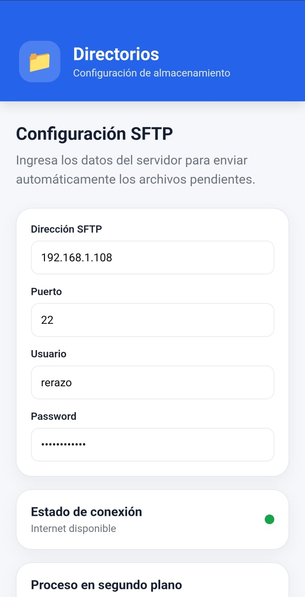
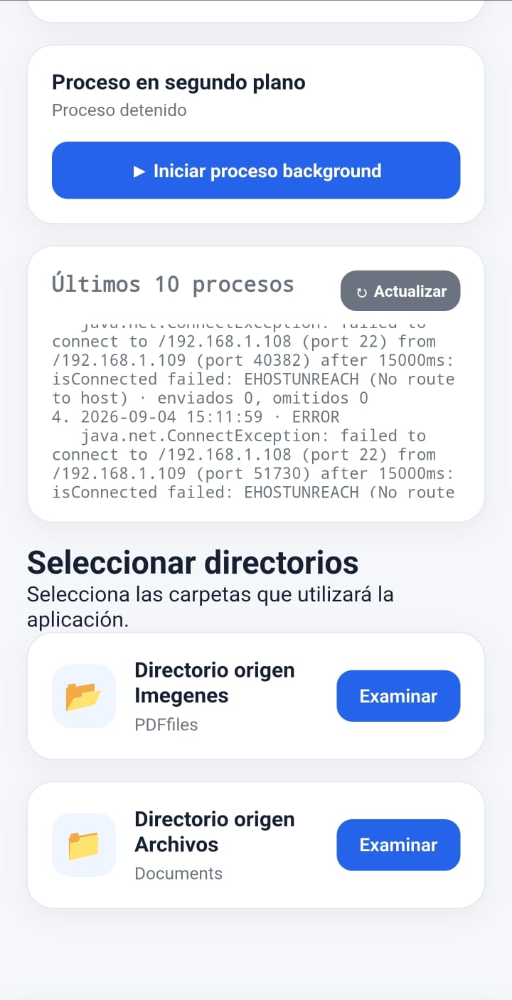

# IGM process – SFTP Background v5

## Intro

Aplicacion Android desarrollada en Cordova que permite, enviar a un SFTP, desde 2 capetas, con un proceso en backend que valida la conexion a Internet para poder hacer el envio, esto permite trabajar offline.





## Nuevas funciones
- Botón **Iniciar proceso background** / **Detener proceso background**.
- El proceso se ejecuta como Foreground Service nativo y puede continuar con la pantalla apagada, sujeto a las restricciones de Android.
- Registro persistente de los **últimos 10 procesos**. Cada proceso guarda fecha/hora, estado, detalle, enviados, omitidos y duración.
- Los logs se guardan en SharedPreferences, no en archivos, evitando llenar el almacenamiento.
- El proceso detenido por el usuario no vuelve a iniciarse automáticamente al detectar Internet.
- Se evita iniciar dos bucles SFTP simultáneamente.
- La configuración SFTP queda persistida para recuperación del servicio.

## Instalación limpia
```bash
rm -rf platforms plugins node_modules
rm -f package-lock.json
npm install
npx cordova platform add android
npx cordova prepare android
npx cordova build android
```

Los logs corresponden a ciclos de sincronización de 30 segundos. Solo se conservan los 10 más recientes; al crear el número 11 se elimina automáticamente el más antiguo.
